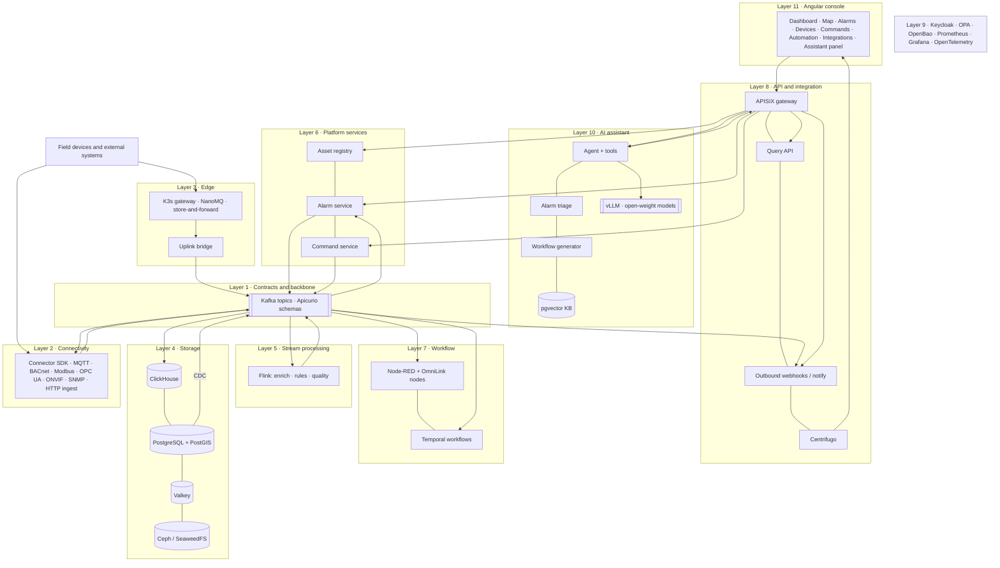

# 02 — Architecture

OmniLink is eleven layers. Every device reading and external message passes through the Kafka backbone before it is stored, acted on or exposed. Security and observability span every layer.

## Key flows

**Telemetry (device → screen, < 2 s):** adapter reads a point → the SDK normalises it to a `TelemetryEvent` → `omnilink.telemetry.v1` → Flink adds device and site context → `omnilink.telemetry.enriched.v1` → ClickHouse (raw + rollups) and the live relay to Centrifugo → console.

**Alarm (< 1 s to raise):** Flink threshold rules emit `RuleHit` on each state change → the alarm service applies the ISA-18.2 lifecycle → `omnilink.alarms.v1` → Temporal starts `IncidentEscalation` for P1/P2, the AI triage worker writes a suggestion, outbound sends webhooks, and the console updates.

**Command (operator → device):** console or assistant → APISIX → command service (role, rate limit, approval) → `omnilink.commands.v1` → the connector executes within its TTL → `CommandResult` → the audit log and console show the result.

**AI action:** the user asks → the agent calls read tools with the user's token → it proposes write actions → the user approves → the action executes with the user's token → the command service applies its own approval rules again.

## Design decisions

| Decision | Why |
| --- | --- |
| Canonical contracts at the connector | Protocol knowledge stays in one layer; everything downstream is uniform |
| Kafka as the single backbone | Replay, decoupling, many independent consumers, exactly-once with Flink |
| ClickHouse for time series | Open source (Apache 2.0) with replication; 10–20× compression; SQL. TimescaleDB's advanced features are not OSI-licensed |
| Temporal + Node-RED instead of n8n | n8n's licence is not OSI open source. Node-RED covers low-code automation; Temporal covers durable, auditable processes |
| The assistant uses the user's identity | The AI can never exceed the user's permissions; write actions need explicit approval |
| Runtime config for the console | One image serves every city and tenant |
